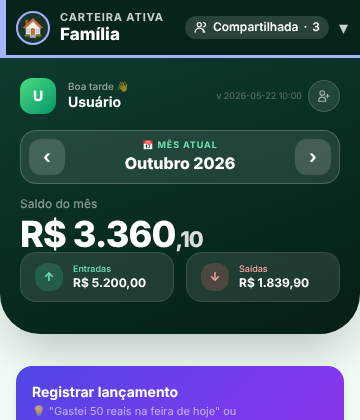
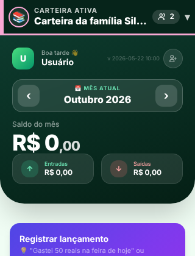
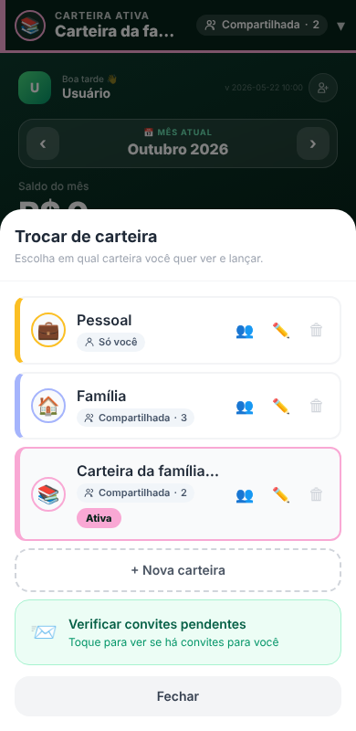

# Relatório — Barra de carteira ativa (`feat/barra-carteira-ativa`)

Sem mudanças de banco (nenhuma migration). Nenhum teste tocou o Supabase de produção. Dados das capturas são fictícios (`exemplo.com`).
**Aviso:** o protótipo (`claude.ai/artifact/Wa3ixpAEKCVKEUC7CkhLLi`) não estava acessível nesta sessão; implementei **a partir das medidas e regras escritas no pedido**. Compare as capturas abaixo com o protótipo e me diga o que destoa.

## O que mudou
| ID | Item | Estado | Arquivos |
|---|---|---|---|
| U1 | `<button id="wallet-bar">` único, no topo de `#main-app` (acima das 4 abas, `position: sticky`), altura 58 px + `env(safe-area-inset-top)`, borda inferior 3 px, faixa 6 px, avatar 34 px com anel 2 px, rótulo "CARTEIRA ATIVA" 11 px, nome 17 px/negrito/ellipsis, chip ("Só você" / "Compartilhada · N"; < 360 px só ícone + número), chevron ▾, `aria-label` "Carteira ativa: {nome} (…). Toque para trocar de carteira", fundo `#06241a` | FEITO | `index.html`, `js/app.js` |
| U2 | `Utils.walletColor(id)`: 8 cores sem verde/vermelho, hash FNV-1a estável do id, aplicada por `--wallet-accent` (sem classes dinâmicas do Tailwind, nada gravado no banco) | FEITO | `js/utils.js` |
| U3 | Tocar na barra abre `#financa-modal` como "Trocar de carteira" (faixa e avatar na cor de cada carteira, nome, chip, selo "Ativa", botões "Fechar" e "+ Nova carteira"); ao escolher: fecha, troca, re-renderiza a aba atual **mantendo o mês** e mostra toast `role="status"` ~2,8 s "Agora vendo: {nome}" com ponto na cor da carteira | FEITO | `index.html`, `js/app.js` |
| U4 | Estados: carregando (esqueleto, `role="status"`, `aria-label` "Carregando carteira"); nenhuma carteira (faixa cinza, "Escolha uma carteira" / "Toque para criar ou entrar em uma"); sem internet (chip âmbar "Sem internet"); nome longo truncado (nome completo no `aria-label`) | FEITO | `index.html`, `js/app.js` |
| U5 | Terminologia: toggle de Investir agora "📈 Investimentos \| 🐷 Cofrinhos"; cabeçalho da aba "Aportes e metas"; "Carteira" só para a conta compartilhável | FEITO | `index.html` |
| U6 | Novo lançamento já mostrava a carteira (cartão "Carteira ativa"); importação e exportação ganharam o rótulo "Entra na carteira: …" / "Carteira: …"; arquivos: `lancamentos-<carteira>-<período>.xlsx/.pdf` e `backup-<carteira>-<data>.xlsx`, sem acentos nem espaços (`Utils.slugFile`) | FEITO | `index.html`, `js/app.js`, `js/utils.js` |
| U7 | `document.title` = "{nome} · Minhas Carteiras"; pílula antiga (`#financa-switcher`, CSS e JS) removida e `renderFinancaSwitcher()` agora alimenta a barra; `?v=` de `utils.js`, `app.js` e `css/app.css` e cache do service worker (`app-runtime-v20261104a`) atualizados; animações só com `prefers-reduced-motion: no-preference` | FEITO | `index.html`, `js/app.js`, `sw.js` |

Decisões de implementação:
- **Nº de membros** (chip "Compartilhada · N"): vem de `Storage.getMembers`, em cache de 30 s, e a barra se atualiza quando o número chega (enquanto isso mostra "Compartilhada" sem número). Carteira do tipo compartilhada/familiar com **1 membro** mostra "Só você". Em modo local (sem nuvem) sempre "Só você".
- O **degradê do cabeçalho da Home por tipo de carteira** (roxo/azul-petróleo/verde) foi mantido; só a pílula saiu.
- Sem carteiras carregadas (cloud) a barra mostra "Escolha uma carteira"; se o carregamento falhar, o app cai na carteira "Pessoal" (comportamento anterior).

## Testes
| Teste | O que prova | Resultado |
|---|---|---|
| T1 `tests/unit/wallet-color.test.js` (4) | cor estável, 8 cores distintas, **nenhuma verde nem vermelha** (matiz), distribuição em 1.000 ids, contraste ≥ 3:1 sobre o fundo | passa |
| T2 `tests/static/wallet-bar.test.js` (12, jsdom) | barra única e fora das abas, visível nas 4 abas; trocar carteira atualiza nome, cor, chip, aria, título e toast (role=status, some em ~2,8 s); **mês mantido**; 1 membro = "Só você"; carregando/vazio/offline; nome longo no aria-label; nome malicioso (``) vira texto na barra, lista, toast e título; "Investimentos"; nomes de arquivo; sem classes dinâmicas | passa |
| T3 `scripts/visual/wallet-bar.js` (Chromium) | 320/360/390/768 px (+1280 desktop) × 4 abas + nome longo + após trocar: **sem overflow horizontal, barra 58 px (alvo ≥ 44 px), chip dentro da barra**, 0 erros de console, requisições externas bloqueadas | 30/30 OK |
| T4 suíte inteira (`npm test`) | inclui scanner de XSS, CSP (hashes), classes do Tailwind e `pages-artifact` | ver PR (CI) |

Contraste medido: nome 16,5:1; rótulo (branco 78 %) 8,5:1; chip "Sem internet" 9:1 (AA exige 4,5:1).

## Capturas (`docs/qa/visual/barra-carteira/`)
`barra-inicio|historico|resumo|investir|nome-longo.<largura>.png` (topo da tela), `trocar-carteira.<largura>.png` (painel) e `barra-apos-trocar-toast.<largura>.png` (toast "Agora vendo"), para 320, 360, 390, 768 e 1280 px; medidas em `medidas.json`.

| 360 px — Início | 320 px — nome longo | 390 px — painel |
|---|---|---|
|  |  |  |

## Limitações / pontos de atenção
- Capturas em modo local (Supabase simulado): o chip "Compartilhada · N" nelas usa o cache de membros preenchido pelo teste; em produção o número vem do banco.
- `safe-area-inset-top` só tem efeito em aparelhos com entalhe (testar num iPhone no checklist).
- A barra é `sticky`: o banner de convite (`#invite-banner`, fixo no topo) a cobre enquanto estiver visível.
- O cartão "Carteira ativa" dentro de Cofrinhos (`#cof-carteira`) e do modal de lançamento continuam existindo (contexto na própria ação, como pedido em U6).
