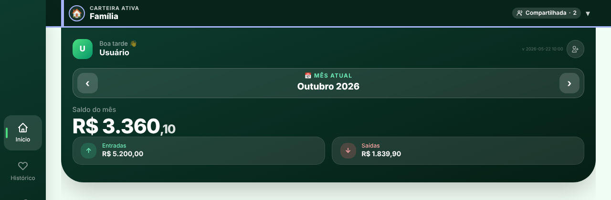
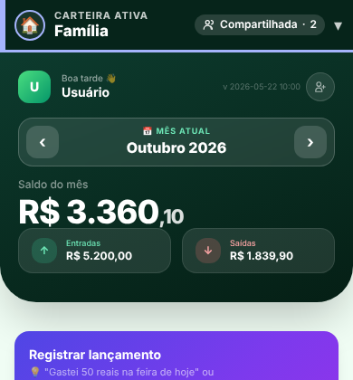

# Relatório — Barra de carteira ativa (`feat/barra-carteira-ativa`)

Sem mudanças de banco (nenhuma migration). Nenhum teste tocou o Supabase de produção. Dados das capturas são fictícios (`exemplo.com`).
**Aviso:** o protótipo (`claude.ai/artifact/Wa3ixpAEKCVKEUC7CkhLLi`) não estava acessível nesta sessão; implementei **a partir das medidas e regras escritas no pedido**. Compare as capturas abaixo com o protótipo e me diga o que destoa.

## O que mudou
| ID | Item | Estado | Arquivos |
|---|---|---|---|
| U1 | `<button id="wallet-bar">` único, no topo de `#main-app` (acima das 4 abas, `position: sticky`), altura 58 px + `env(safe-area-inset-top)`, borda inferior 3 px, faixa 6 px, avatar 34 px com anel 2 px, rótulo "CARTEIRA ATIVA" 11 px, nome 17 px/negrito/ellipsis, chip ("Só você" / "Compartilhada · N"; < 360 px só ícone + número), chevron ▾, `aria-label` "Carteira ativa: {nome} (…). Toque para trocar de carteira", fundo `#06241a` | FEITO | `index.html`, `js/app.js` |
| U2 | `Utils.walletColor(id)`: 8 cores sem verde/vermelho, hash FNV-1a estável do id, aplicada por `--wallet-accent` (sem classes dinâmicas do Tailwind, nada gravado no banco) | FEITO | `js/utils.js` |
| U3 | Tocar na barra abre `#financa-modal` como "Trocar de carteira" (faixa e avatar na cor de cada carteira, nome, chip, selo "Ativa", botões "Fechar" e "+ Nova carteira"); ao escolher: fecha, troca, re-renderiza a aba atual **mantendo o mês** e mostra toast `role="status"` ~2,8 s "Agora vendo: {nome}" com ponto na cor da carteira | FEITO | `index.html`, `js/app.js` |
| U4 | Estados: carregando (esqueleto, `role="status"`, `aria-label` "Carregando carteira"); nenhuma carteira (faixa cinza, "Escolha uma carteira" / "Toque para criar ou entrar em uma"); sem internet (chip âmbar "Sem internet"); nome longo truncado (nome completo no `aria-label`) | FEITO | `index.html`, `js/app.js` |
| U5 | Terminologia: toggle de Investir agora "📈 Investimentos \| 🐷 Cofrinhos"; cabeçalho da aba "Aportes e metas"; "Carteira" só para a conta compartilhável | FEITO | `index.html` |
| U6 | Novo lançamento já mostrava a carteira (cartão "Carteira ativa"); importação e exportação ganharam o rótulo "Entra na carteira: …" / "Carteira: …"; arquivos: `lancamentos-<carteira>-<período>.xlsx/.pdf` e `backup-<carteira>-<data>.xlsx`, sem acentos nem espaços (`Utils.slugFile`) | FEITO | `index.html`, `js/app.js`, `js/utils.js` |
| U7 | `document.title` = "{nome} · Minhas Carteiras"; pílula antiga (`#financa-switcher`, CSS e JS) removida e `renderFinancaSwitcher()` agora alimenta a barra; `?v=` de `utils.js`, `app.js` e `css/app.css` e cache do service worker (`app-runtime-v20261104a`) atualizados; animações só com `prefers-reduced-motion: no-preference` | FEITO | `index.html`, `js/app.js`, `sw.js` |

Decisões de implementação:
- **Chip de tipo = membros reais** (ver Correção 1 abaixo): `Utils.walletChip(financa, n)`; o `type` da carteira nunca é consultado.
- O **degradê do cabeçalho da Home por tipo de carteira** (roxo/azul-petróleo/verde) foi mantido; só a pílula saiu.
- Sem carteiras carregadas (cloud) a barra mostra "Escolha uma carteira"; se o carregamento falhar, o app cai na carteira "Pessoal" (comportamento anterior).

## Testes
| Teste | O que prova | Resultado |
|---|---|---|
| T1 `tests/unit/wallet-color.test.js` (4) e `tests/unit/wallet-chip.test.js` (6) | cor estável, 8 cores distintas, **nenhuma verde nem vermelha** (matiz), distribuição em 1.000 ids, contraste ≥ 3:1 sobre o fundo | passa |
| T2 `tests/static/wallet-bar.test.js` (12, jsdom) | barra única e fora das abas, visível nas 4 abas; trocar carteira atualiza nome, cor, chip, aria, título e toast (role=status, some em ~2,8 s); **mês mantido**; 1 membro = "Só você"; carregando/vazio/offline; nome longo no aria-label; nome malicioso (``) vira texto na barra, lista, toast e título; "Investimentos"; nomes de arquivo; sem classes dinâmicas | passa |
| T3 `scripts/visual/wallet-bar.js` (Chromium) | 320/360/390/768 px (+1280 desktop) × 4 abas + nome longo + após trocar: **sem overflow horizontal, barra 58 px (alvo ≥ 44 px), chip dentro da barra**, 0 erros de console, requisições externas bloqueadas | 30/30 OK |
| T4 suíte inteira (`npm test`) | inclui scanner de XSS, CSP (hashes), classes do Tailwind e `pages-artifact` | ver PR (CI) |

Contraste medido: nome 16,5:1; rótulo (branco 78 %) 8,5:1; chip "Sem internet" 9:1 (AA exige 4,5:1).

## Capturas (`docs/qa/visual/barra-carteira/`)
`barra-inicio|historico|resumo|investir|nome-longo.<largura>.png` (topo da tela), `trocar-carteira.<largura>.png` (painel) e `barra-apos-trocar-toast.<largura>.png` (toast "Agora vendo"), para 320, 360, 390, 768 e 1280 px; medidas em `medidas.json`.

| 360 px — Início | 320 px — nome longo | 390 px — painel |
|---|---|---|
|  |  |  |

## Limitações / pontos de atenção
- Capturas em modo local (Supabase simulado): o chip "Compartilhada · N" nelas usa o cache de membros preenchido pelo teste; em produção o número vem do banco.
- `safe-area-inset-top` só tem efeito em aparelhos com entalhe (testar num iPhone no checklist).
- A barra é `sticky`: o banner de convite (`#invite-banner`, fixo no topo) a cobre enquanto estiver visível.
- O cartão "Carteira ativa" dentro de Cofrinhos (`#cof-carteira`) e do modal de lançamento continuam existindo (contexto na própria ação, como pedido em U6).

---

# CORREÇÃO 1 — chip "Só você" em carteira compartilhada

## Diagnóstico (feito antes de mudar qualquer coisa)
O erro foi introduzido por mim na primeira versão da barra.

**a) De onde vinha o texto do chip.** De `App._walletKind(f)`, que decidia pelo **`financas.type`**: `individual` → "Só você" fixo, sem olhar membros. Só para tipos ≠ individual ele consultava um cache de membros, e quando o cache estava vazio caía em valores padrão ("Compartilhada" sem número na nuvem; "Só você" no modo local). Os outros lugares que mostram o tipo usavam o `type` direto: `#financa-select-modal` (`👥 Compartilhada` / `👤 Individual`), o rótulo do novo lançamento (`#modal-financa-type`), o banner da importação e o cartão da carteira em Cofrinhos.
**b) Onde/quando os membros eram carregados.** Só por `_loadWalletMembers(f)` (código meu): apenas para a carteira **ativa**, apenas se `type !== 'individual'`, na nuvem e online, com cache de 30 s. Para uma carteira "individual" que ganhou membros **a contagem nunca era pedida**. Também não existia antes da 1ª renderização: a barra é desenhada logo após `loadFinancas()` e o número chegava depois (ou nunca). As demais chamadas de `Storage.getMembers(fid)` existentes são sob demanda (painel de compartilhar, autor do lançamento) e não alimentavam a barra.
**c) A policy deixa ver todos os membros?** Sim. `members_select` = `is_financa_member(financa_id)` (dono ou membro): quem participa da carteira lê **todas** as linhas de `financa_members` dela. Confirmado com teste real no Postgres de teste (estado de produção): `tests/db/members-visibility.test.js` (5 testes) — carteira criada como `individual` com admin + membro: o admin vê 2, **o membro comum também vê 2**, o estranho vê 0; uma única consulta agregada devolve a contagem de todas as carteiras; convite pendente **não** vira linha de `financa_members` (o admin o vê à parte, o membro não); remover um membro baixa a contagem para 1.

## Regra nova (fonte da verdade = `financa_members`)
`Utils.walletChip(financa, memberCount)` — função única; o `type` é ignorado.
| memberCount | resultado |
|---|---|
| `undefined` (ainda não carregou) | esqueleto cinza (barra e lista); **nunca** "Só você" por padrão |
| `null`, 0, inválido (falha/sem dado) | chip **oculto**, sem texto |
| 1 | "Só você" (ícone de pessoa) |
| ≥ 2 | "Compartilhada · n" (ícone de pessoas) |
Convites pendentes não contam; "· 1 convite" aparece **só no painel de troca** e só para admin (RLS já esconde convites de quem não é admin).

**Carga e cache:** `Storage.getMemberCounts()` faz **uma** consulta (`financa_members`: `financa_id, user_id, role`) e conta por carteira; uma segunda consulta, opcional, traz os convites pendentes (admin). Cache em `App._wc` (estado idle/loading/loaded/error; mostra o valor antigo enquanto recarrega; ignora respostas velhas). É invalidado e recarregado ao: carregar as carteiras, **trocar de carteira**, **aceitar convite**, **adicionar** (`inviteMember`) ou **remover** membro, **cancelar** convite, **criar** ou **excluir** carteira (ganchos em `Storage`, que chamam `App.invalidateWalletMembers()`).
**Onde se aplica (todos usam a mesma função):** `#wallet-bar`, `#financa-modal`, `#financa-select-modal`, rótulo do novo lançamento (`#modal-financa-type`), banner da importação e cartão/formulário de Cofrinhos.

## Testes da correção
- `tests/unit/wallet-chip.test.js` (6): n=1, n=2, n=5, `undefined` → esqueleto, `null`/inválido → oculto, `type='individual'` com n=2 → "Compartilhada · 2".
- `tests/static/wallet-bar.test.js` (jsdom, +8): carteira criada como individual com 2 membros mostra "Compartilhada · 2" **na barra e na lista**; esqueleto e nunca "Só você" antes da contagem; **uma única consulta** para todas as carteiras; **`Storage.removeMember` real → chip volta a "Só você" sem recarregar a página** (e `acceptInvite` → volta a "Compartilhada · 2"); falha → chip oculto; "· 1 convite" só na lista; troca recarrega a contagem; mesmo rótulo no select-modal/novo lançamento/importação; nenhuma decisão por `type` restante no código.
- `tests/db/members-visibility.test.js` (5, Postgres): ver 1c.

## Proposta (NÃO aplicada): sincronizar `financas.type` com a realidade
Hoje `type` fica desatualizado quando uma carteira "individual" recebe membros. Sugestão para depois, sem urgência (o app não depende mais dele para o chip): em vez de gravar, **deixar de usar** o `type` para decisões de exibição; se quiser mantê-lo, um trigger em `financa_members` (insert/delete) que ajuste `financas.type` para `compartilhada` quando houver ≥ 2 linhas e `individual` quando houver 1. Não apliquei nada no banco e não há migration nesta branch.

## Limitações conhecidas desta correção
- Contagem = nº de **linhas** em `financa_members`. Carteira sem nenhuma linha (dono sem linha de membro — o app sempre insere o dono como admin, mas dados antigos podem não ter) fica **sem chip** em vez de "Só você" errado. Se existir, vale um script de verificação em produção (somente leitura): carteiras sem linhas em `financa_members`.
- Uma consulta devolve no máximo 10.000 linhas (limite do cliente; o PostgREST do Supabase pode limitar a 1.000 por padrão) — suficiente para uso familiar.

---

# CORREÇÃO 2 — barra espalhada no desktop

O fundo continua ocupando a largura toda, mas o conteúdo (faixa, avatar, nome, chip, chevron) agora fica num container `.wb-inner` com **a mesma largura e centralização da coluna do app**: no celular/tablet a largura do próprio `body` (até 760 px) e, no desktop (≥ 1024 px, ao lado do menu lateral), o mesmo `max-width` de `.tab-page` (1120 px; 1280 px a partir de 1440 px), com `margin: 0 auto`.
Verificação no Chromium (`scripts/visual/wallet-bar.js`): a coluna da barra coincide com a da aba visível (±1 px) e avatar/chevron ficam dentro dela — 768 px: 4–764; 1280 px: **128–1248 (aba 128–1248)**; 30/30 verificações OK.

| 1280 px — Família (2 membros) | 390 px — Família (2 membros) |
|---|---|
|  |  |
