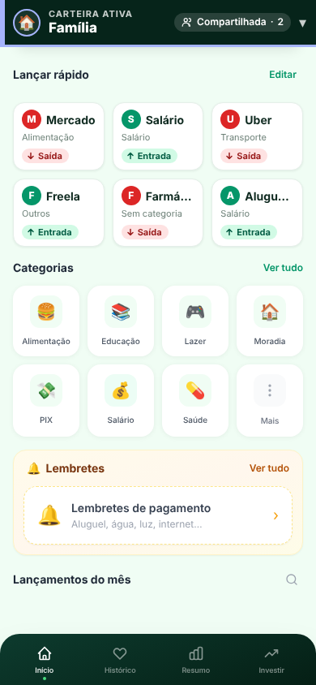
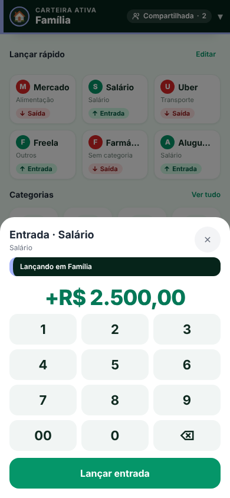
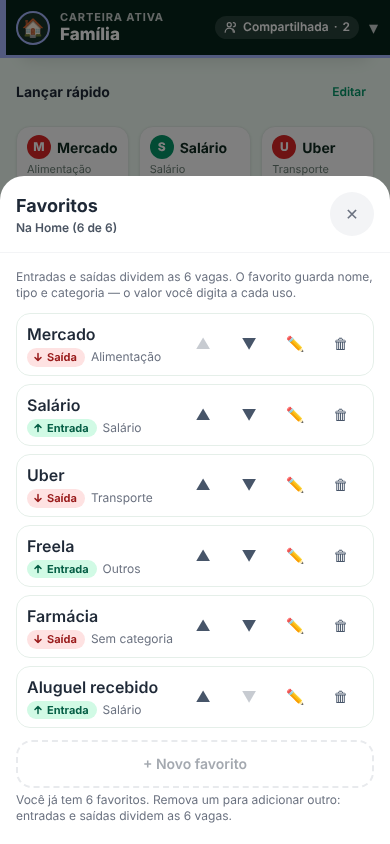

# Onda 1 — Favoritos de um toque + atalhos no ícone do app (`feat/onda1-favoritos-atalhos`)

**Migration NÃO aplicada em produção** (arquivos prontos para revisão). Nenhum teste tocou o Supabase de produção. Sem dados, e-mails ou UUIDs reais (fixtures com `…@teste.com` / `exemplo.com` e UUIDs `00000000-…`).
O protótipo de referência (`claude.ai/artifact/Wa3ixpAEKCVKEUC7CkhLLi`) não estava acessível nesta sessão: implementei a partir das regras escritas (telas 1, 2 e 4), **sem valor nos favoritos**. Compare as capturas com o protótipo.

## Decisão de produto (fixa)
Favorito = **nome + categoria + TIPO (entrada | saída)**, definidos pelo usuário. **Nunca valor** (digitado a cada uso). Por usuário **e** por carteira; **máximo de 6 no total** (entradas + saídas juntas).

## F1 — modelo de tipo que encontrei e reaproveitei
| Onde o app guarda o tipo hoje | Valores |
|---|---|
| `transactions.type` (`VARCHAR(10)`, `CHECK … IN ('entrada','saida')` na migration de criação) | ids fixos **`'entrada'`** e **`'saida'`** (o app os chama de "Entrada (Receita)" e "Saída (Gasto)", `behavior` soma / subtrai) |
| `categories.type` (`CHECK … IN ('entrada','saida','both')`) | os mesmos dois + `'both'` (serve aos dois) |
| `transaction_types` / ids `ct…` | tipos **personalizados** (soma/subtrai/neutro) — **fora desta onda**: a decisão foi "entrada ou saída" |

`favorite_entries.type` usa **exatamente a mesma coluna (`type`) e os mesmos dois valores**; nenhum tipo novo. `NOT NULL` + `CHECK (type in ('entrada','saida'))` (`'both'` é válido só em categoria). Regra de compatibilidade com a categoria: `categories.type = 'both'` **ou** igual ao tipo do favorito.
O saldo segue a regra que o app já tem (`Storage.getBehavior`: entrada soma, saída subtrai) — o favorito só grava `type` na transação e a Home recalcula.

## O que mudou
| ID | Item | Estado | Arquivos |
|---|---|---|---|
| F1 | Tabela `favorite_entries` (id, financa_id, user_id, name, **type**, category_id, position, created_at); `CHECK` de nome 1–40 (aparado); **índice único `(user_id, financa_id, type, lower(btrim(name)))`** (mesmo nome em tipos diferentes OK; duplicado no mesmo tipo, não); RLS select/insert/update/delete só do dono **e** com papel que pode lançar (dono da carteira, `admin` ou `membro` — **visualizador não cria nem lê**); `WITH CHECK`: categoria da **mesma `financa_id`** (anti-injeção da Fase 2) **e** de tipo compatível; trigger do **7º favorito** (conta o total, com trava contra corrida); `user_id`/`financa_id` imutáveis; sem `anon`; função nova `can_write_financa` com `search_path` fixo | FEITO, **não aplicado** | `supabase/migrations/20261104000001_favorite_entries.sql`, `docs/qa/rollback-favorite-entries.sql`, `docs/qa/verificacao-favoritos.sql` |
| F2 | Seção **"Lançar rápido"** na Home (grade de 3 colunas, até 6 botões ≥ 44 px, ~84 px de altura): inicial, nome, categoria e **selo de tipo** ("↓ Saída" / "↑ Entrada": ícone + texto). Sem favoritos: cartão "Crie seus favoritos para lançar com um toque" + Adicionar. Oculta para visualizador. Painel inferior: título com o tipo ("Saída · Mercado"), categoria, faixa **"Lançando em {carteira}"** na cor da carteira, valor com prefixo **-** / **+**, **teclado de centavos** (1–9, 00, 0, apagar; teto R$ 9.999.999,99), botão **"Lançar saída" / "Lançar entrada"** (desabilitado com valor zero e durante o envio), foco no painel ao abrir/volta ao botão ao fechar, Esc, `aria-label` nas teclas, `prefers-reduced-motion`. Lançar: `Storage.addTransaction` (offline/fila já existentes), descrição = nome, tipo do favorito, data local, autor = usuário atual; toast `role="status"` "Lançado: {nome} {±valor} ({tipo})" com **Desfazer** (≥ 44 px, 6 s) que apaga **só** o id criado; falha mantém o painel e o valor | FEITO | `js/favorites.js`, `js/favorites-ui.js`, `index.html`, `js/app.js` |
| F3 | Sugestões no cliente: últimos 60 dias, agrupa por **(descrição normalizada, tipo)**, ≥ 3 ocorrências, ignora favoritas do mesmo tipo, categoria mais usada, sem valor; nada vira favorito sozinho | FEITO | `js/favorites.js` |
| F4 | Gerenciar ("Editar" na seção): lista com selo de tipo, subir/descer (botões acessíveis), editar, remover com confirmação leve (2º toque), contador **"Na Home (n de 6)"** + "Entradas e saídas dividem as 6 vagas"; criar/editar com seletor **Saída \| Entrada** + nome (≤ 40, aparado) + categoria (ao trocar o tipo, categoria incompatível é limpa e pede nova); "Sugeridos pelo seu histórico — Lançou N vezes nos últimos 60 dias"; com 6, "Adicionar" desabilitado com explicação; categoria apagada → "Sem categoria" | FEITO | `js/favorites-ui.js` |
| F5 | `manifest.json` → 3 `shortcuts`: Novo gasto (`./?action=new-expense`), Nova entrada (`./?action=new-income`), Histórico (`./?action=history`). Allowlist fixa; guardado em `sessionStorage` se ainda não logado; executa **depois do login e de `loadFinancas`**; limpa só o `action` da URL (`history.replaceState`). `new-*` abre o modal existente com o tipo e foco no valor. SW: navegação ignora a query no cache (serve o app offline) e versão atualizada | FEITO | `manifest.json`, `js/app.js`, `js/auth.js`, `sw.js` |
| F6 | `Metrics` (localStorage, sem rede): por método (favorito, formulário, texto rápido, atalho) → quantidade, mediana de toques e de segundos; `Metrics.summary()` no console; sem UI | FEITO | `js/metrics.js`, `js/app.js` |

**Obs. F5:** o manifest já tinha 2 atalhos antigos (`?action=new-transaction` e "Início"), que **nenhum código tratava**; foram substituídos pelos 3 pedidos. **iOS não suporta** atalhos no ícone (documentado; sem gambiarra). Os atalhos ficaram **sem ícone próprio** (não há ícones adequados no repositório; o do app seria genérico).

## Decisões e pontos de atenção
1. **Coluna `type`**, não "tipo": mesmo nome usado por `transactions` e `categories` (reaproveita o modelo).
2. **Papel no banco ≠ papel nas lançamentos:** as policies de `transactions` (Fase 2, decisão D1) **não** checam papel — só a tela barra o visualizador. Para favoritos o pedido foi barrar no banco, então criei `can_write_financa` (dono, admin ou membro). Se quiser o mesmo rigor em `transactions`, é outra migration.
3. **"Alternar na Home"** (F4) = favorito existir (está na Home) ou ser removido; o contador "Na Home (n de 6)" conta todos. Não criei coluna de "visível" (o modelo pedido não a tem).
4. **Categorias padrão** (ids `d-…`, que existem só no app) não têm linha no banco: não podem ser usadas em favoritos (o seletor só lista categorias reais da carteira; sem categoria, o lançamento usa "Outros").
5. **Favoritos offline:** a lista vem do cache local; criar/editar/remover exigem internet (mensagem clara); **lançar** segue o comportamento offline que o app já tem (fila).
6. **Modo local** (sem nuvem): favoritos ficam no aparelho (localStorage), sem o banco.
7. Valor: o teclado trabalha em **centavos inteiros**; a transação recebe `Utils.roundMoney(centavos/100)` (sem float acumulado).

## Testes
| Teste | O que prova | Resultado |
|---|---|---|
| T1 `tests/unit/favorites.test.js` (10) | normalização; sugestões (limiar 3, janela de 60 dias inclusive, ignora favoritas do mesmo tipo, categoria mais usada, **mesmo nome em tipos diferentes = 2 sugestões**); teclado de centavos (1,5,0,0 = 1500; 00; apagar; teto; nunca negativo); validação (duplicado, limite 6 total, categoria compatível/padrão); `Metrics` | passa |
| T2 `tests/static/favorites.test.js` (jsdom, 16) | 0 a 6 favoritos; selo + rótulo corretos nos dois tipos, sem valor; painel (nome, categoria, carteira/cor); valor zero desabilita; **payload exato** do insert (descrição, categoria, tipo, data local, valor); **3 toques = 1 insert**; saída **subtrai** e entrada **soma** no saldo; Desfazer apaga só o id criado; trocar de carteira troca os favoritos; visualizador não vê (e papel desconhecido não pisca); falha mantém painel e valor; editor limpa categoria incompatível; **7º favorito (misto) bloqueado com mensagem**; XSS; foco/Esc; alvos ≥ 44 px | passa |
| T3 `tests/static/shortcuts.test.js` (jsdom, 5) | manifest válido, ≤ 4 atalhos, mesma origem/escopo; allowlist rejeita `?action=qualquer-coisa` (e variantes); parâmetro espera carteiras e **sobrevive ao login**; URL limpa depois de executar; SW | passa |
| T4 `scripts/visual/favorites.js` (Chromium) | 320/390/768 px: Home com 0, 3 e 6 favoritos (mistos), painel nos dois tipos, toast, gerenciar, editor: **sem overflow horizontal, todos os alvos ≥ 44 px, 0 erros** | 24/24 OK |
| T5 `tests/db/favorites.test.js` (Postgres local) | roda `docs/qa/verificacao-favoritos.sql`: **33/33 casos** (resultado em `docs/qa/verificacao-favoritos-resultado.md`); migration aplica, RLS ligada, `anon` sem acesso; **rollback + reaplicação** (2×) | passa |
| T6 suíte completa | inclui CSP (sem inline novo), build do site, XSS, Tailwind | **234/234**; CI no PR |

Casos de SQL do F1: (a) mesmo nome em tipos diferentes é aceito; (b) mesmo nome no mesmo tipo é rejeitado; (c) categoria de tipo incompatível é rejeitada; (d) tipo nulo, inválido (`xpto`, `both`) é rejeitado; (e) 7º favorito misturando tipos é rejeitado — além de B não ler/inserir/editar/apagar favorito de A, não membro e **visualizador** barrados, categoria de outra carteira rejeitada, nome vazio/41 caracteres rejeitados, `user_id`/`financa_id` imutáveis, `anon` negado.

## Capturas (`docs/qa/visual/onda1-favoritos/`, 320/390/768 px)
`home-0-favoritos`, `home-3-favoritos`, `home-6-favoritos`, `painel-saida`, `painel-entrada`, `toast-desfazer`, `gerenciar`, `editor` + `medidas.json`.

| Home com 6 (390 px) | Painel — entrada | Gerenciar |
|---|---|---|
|  |  |  |

## Como aplicar (ordem) e reverter
1. **Revisar** a migration; rodar `docs/qa/verificacao-favoritos.sql` num banco **local/branch** (já roda no CI).
2. Aplicar `supabase/migrations/20261104000001_favorite_entries.sql` no SQL Editor (nova tabela e funções; não altera nada existente). Conferir: `select count(*) from public.favorite_entries;` (0) e `select policyname from pg_policies where tablename='favorite_entries';` (4 linhas).
3. Merge do PR (o app **sem a tabela** mostra "Não foi possível carregar os favoritos" com "Tentar de novo"; o resto do app não é afetado).
4. Smoke: criar 1 favorito de saída e 1 de entrada, lançar, **Desfazer**; segurar o ícone do app (Android) → Novo gasto.
- **Reverter front:** "Revert" do PR. **Reverter banco:** `docs/qa/rollback-favorite-entries.sql` (apaga a tabela e os favoritos).

## Pendências / não feito (fora do escopo)
- Novo formulário "Novo gasto" com teclado próprio (tela 3), valor nos favoritos e importação bancária: **não feitos**, como combinado.
- Rodar a verificação SQL num **branch do Supabase** (só há o Postgres local de teste neste ambiente; o CI repete no Postgres 16).
- Ícones dedicados para os atalhos; teste em aparelho Android real (atalho no ícone) e iOS (sem suporte).
